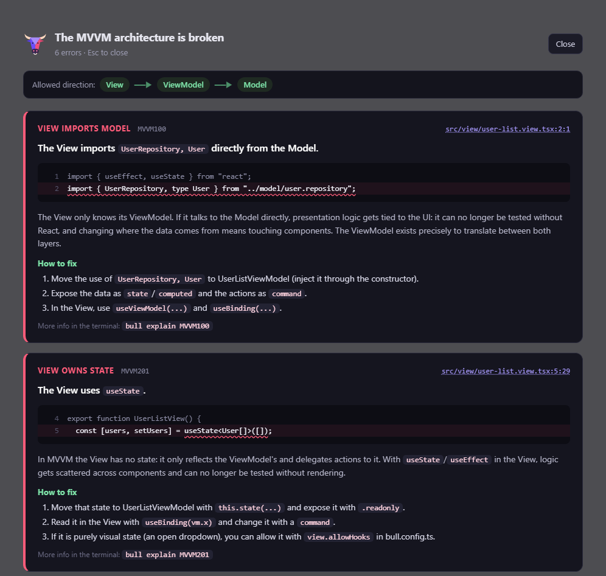

```bash
bull [root] [--port <port>] [--open] [--host [host]] [--mode <mode>] [--config <file>]
bull dev [root]
```

Starts Vite with React Fast Refresh and the Bull plugin. On start and on every file change under
`src/`, the project is re-analyzed:

- the terminal prints the full report when violations change, and
  `✓ MVVM architecture ok · every violation was fixed` when they go away;
- the browser shows an **overlay** with one card per violation: the code frame, the reason, the
  steps to fix it, a link that opens the file in your editor, and a note when `bull fix` can
  repair it.



Press <kbd>Esc</kbd> or **Close** to collapse the overlay into a small pill; it opens again when a
new error appears. With `dev.overlay: "blocking"` in `bull.config.ts` it cannot be closed until
the code respects MVVM. `false` turns it off.

| Option | Meaning |
|---|---|
| `--port <port>` | Port (also `dev.port` in the config). |
| `--open` | Open the browser (also `dev.open`). |
| `--host [host]` | Expose the server on the network. |
| `--mode <mode>` | Vite mode, for `.env.<mode>` files. Defaults to `development`. |
| `--config <file>` | Use this file instead of `bull.config.ts`. |

Extra Vite options (proxy, aliases, plugins) go in the `vite` key of
[bull.config.ts](../../configuration/).
